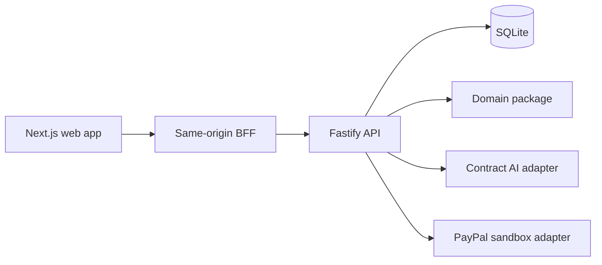

# Architecture

Fairshare keeps agreement interpretation, allocation, and payment reconciliation separate so that no model output or browser input can directly move money.

`apps/web` holds the user interface and proxies allowed same-origin requests to the API. It keeps the session cookie at the web boundary; it does not expose API credentials to the browser.

`apps/api` authenticates users, applies workspace and collaboration authorization, persists state in SQLite, and coordinates domain transitions. New PDF and DOCX uploads retain original bytes with extracted text in that private database; every download rechecks membership and is an attachment, never a public link. The API starts in SANDBOX by default; `DEMO_MODE=true` selects an isolated synthetic-data mode. The two modes reject a shared database.

Workspace owners can create a private member/viewer invitation link. It is a single-use, 48-hour bearer token: the database stores only its hash, the web UI places the raw token in the URL fragment and page memory, and the recipient must sign in before accepting it. It is not proof of mailbox ownership, does not grant OWNER, and has no effect on approvals or money movement. Email invitations keep their separate verified-email and delivery requirements.

`packages/domain` is the source of deterministic allocation behavior. It requires a unanimously approved rule version before activation, uses integer cents and basis points, and treats allocation as distinct from an outgoing payout.

`packages/contract-ai` accepts authorized text on the server and returns source-bound observations for human review. Its output cannot create an active rule version, calculate money, or invoke payment functions.

`packages/payments` is server-only and sandbox-only. It preserves idempotency and reconciliation boundaries around provider writes. The optional reconciliation worker is enabled only with `PAYPAL_RECONCILIATION_ENABLED=true`; it reads and reconciles known operations and does not create orders, capture payments, dispatch payouts, or retry money-moving writes.

Review discussion comments are separate from rule and approval transitions. A checkout may carry an immutable organizer-entered payment-source label, but that label never imports external revenue or proves a provider outcome. Password reset uses the existing authorized email transport.

Local OCR is an API-host option, disabled by default. It requires Poppler and Tesseract and only processes a scan after the user opts in; normal text-layer PDF parsing never falls back to OCR. Authenticator MFA is available only when the operator supplies `FAIRSHARE_MFA_ENCRYPTION_KEY` and keeps that key with the database backup. `HACKATHON_MFA_SIMULATION=true` is a separate synthetic-account option for non-production SANDBOX only; startup rejects it in DEMO, production, or live-PayPal configuration. The flag applies process-wide to accounts without an existing real authenticator, so it requires a dedicated synthetic-only database. It never bypasses a real authenticator record and is not account protection.

For route-level behavior see [API flows](API-FLOWS.md), document boundaries in [source documents](security/source-documents.md), and operational acceptance in [release readiness](RELEASE-READINESS.md).
