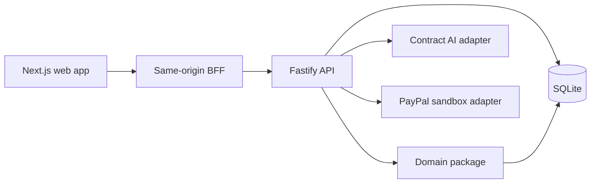

# Architecture

Fairshare keeps agreement interpretation, allocation, and payment reconciliation separate so that no model output or browser input can directly move money.

`apps/web` holds the user interface and proxies allowed same-origin requests to the API. It keeps the session cookie at the web boundary; it does not expose API credentials to the browser.

`apps/api` authenticates users, applies workspace and collaboration authorization, persists state in SQLite, and coordinates domain transitions. The API starts in SANDBOX by default; `DEMO_MODE=true` selects an isolated synthetic-data mode. The two modes reject a shared database.

`packages/domain` is the source of deterministic allocation behavior. It requires a unanimously approved rule version before activation, uses integer cents and basis points, and treats allocation as distinct from an outgoing payout.

`packages/contract-ai` accepts authorized text on the server and returns source-bound observations for human review. Its output cannot create an active rule version, calculate money, or invoke payment functions.

`packages/payments` is server-only and sandbox-only. It preserves idempotency and reconciliation boundaries around provider writes. The optional reconciliation worker is enabled only with `PAYPAL_RECONCILIATION_ENABLED=true`; it reads and reconciles known operations and does not create orders, capture payments, dispatch payouts, or retry money-moving writes.

For route-level behavior see [API flows](API-FLOWS.md), and for the operational acceptance boundary see [release readiness](RELEASE-READINESS.md).
